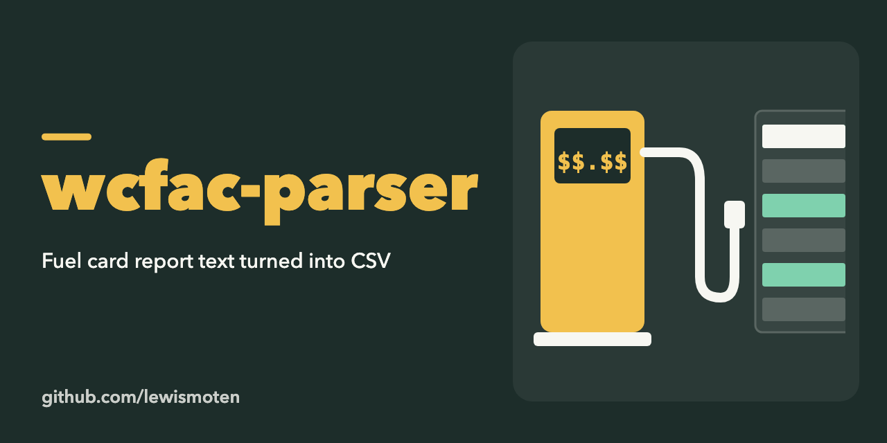

# wcfac-parser

A Node script that turns text copied from fuel card transaction reports (the kind found in board of supervisors packets) into a CSV file for spreadsheets.

## Run

Put the report text in `txt/<date>.txt`, set `date` at the top of `index.js` (`index-june.js` is an earlier variant), then:

```bash
npm start
```

It reads `txt/<date>.txt` and writes `txt/<date>.csv`, printing page, record and VIN counts.

## The request this started from

A raw data export of data used for fuel reports, commonly found in the board of supervisors board packets and reviewed by the finance/audit committee each month. I can see the data in PDF reports, but it is very difficult to bring the data into a spreadsheet. I would like the data in a machine readable format such as excel, xml, or CSV.

The fields that I am most interested in are:

Vehicle Id
Vehicle Description
VIN
Odometer
MPG
Product
Quantity (Gallons)
Original Cost
Merchant Address
Date
Time
Agency Id
Agency Name
Tag
Card
PPU
Transaction Number
Opis
Federal Subtact
State Tax Subtracted
Cost

I'm noticing that the fields for OPIS, Federal Subtract, State Tax Subracted, and cost do not consolidate into the original value, and are off by 5-9% on each transaction. If there are other deductions, I would like to see those as well.

I would like to see this data from January 1, 2025 to the current date.
